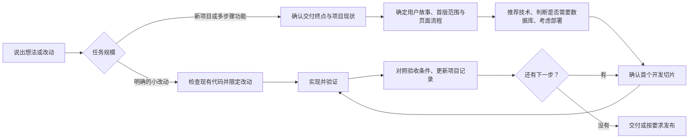
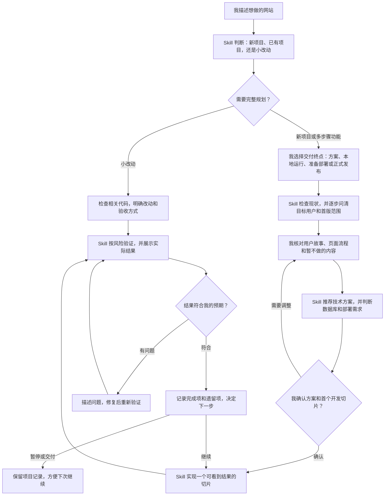
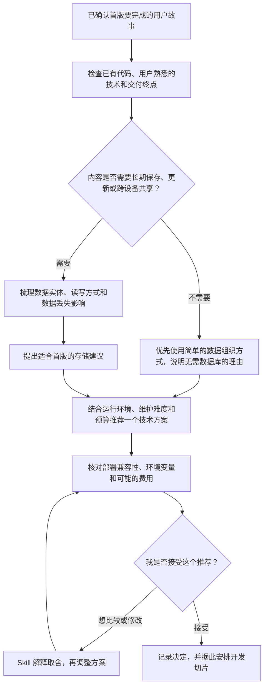
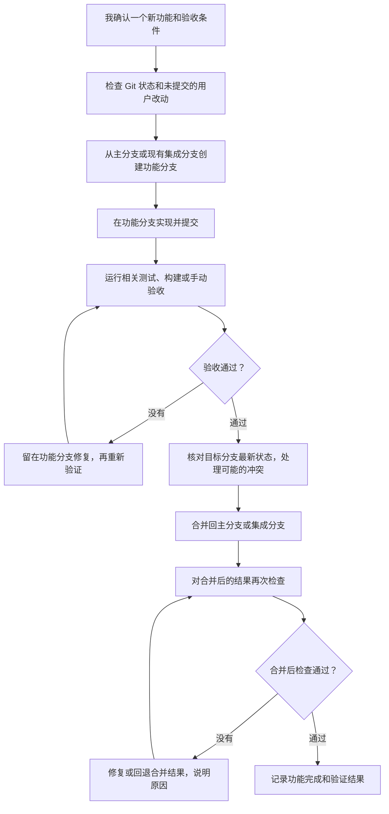

# Vibe Coding Workflow

一个面向编程新手的 Codex Skill：把小型 Web 项目从模糊想法推进到可检查的结果，并在开发过程中保持需求、代码和验收一致。

首版适合公开展示类网站，也能接手已有小型 Web 项目的多步骤改动。它提供工作流程，不绑定某个前端框架、数据库或部署平台。

## 它会怎么带你做



- **先分流：**小改动走简化流程；新项目和多步骤功能先梳理目标与范围。
- **先问交付终点：**选择只要方案、本地可运行、准备部署或正式发布。Codex 根据目标调整技术和验证深度。
- **先看现状：**已有项目会检查说明文档、相关代码、运行方式和 Git 状态，保留用户未提交的改动。
- **让关键决定可追踪：**P0 用户故事对应页面行为、开发切片和验收结果；已确认的决定保存在项目 `docs/`。
- **技术按需选择：**先考虑用户熟悉的技术及现有项目约定，再决定数据库和部署方式。易变的平台能力、兼容性和价格按需查官方资料。
- **小步交付：**每个切片有目标、范围和可观察的验收行为。验证失败会继续处理，不会把未运行的检查写成“通过”。

### Git 分支规则

开发新功能时，从主分支或项目现有的集成分支创建功能分支，在分支上开发和验证。相关验收通过后再合并；若合并时主分支有变化或出现冲突，对合并结果重新检查。明确的小修复可按项目习惯决定是否开分支。远端 GitHub 仓库是可选项。

## 详细流程草图

下面三张图从使用者视角展开主要决定和开发步骤。实际流程会按任务规模与用户选择的交付终点调整。

### 1. 我从一个想法开始



用户只需用自然语言描述目标；重要产品决定由用户确认。已明确给出的信息不重复询问。

### 2. 技术、数据库和部署怎么决定



版本、平台能力或价格等易变信息需要核验当前官方资料。正式资源和发布操作按用户选定的交付程度推进。

### 3. 新功能如何经过 Git 分支回到主分支



明确的小修复可按项目习惯决定是否开分支。新功能会先在功能分支通过相关验收，再合入主分支；合并后的检查用于发现集成问题。

## 适用范围

首版重点是简单的公开展示页面。登录、管理后台、文件上传、支付和敏感数据处理需要增加产品、权限、数据及部署设计；遇到这些需求，Skill 会先说明范围变化，再按确认后的目标规划。

## 安装与调用

推荐用 `npx` 安装到 Codex 个人 Skill 目录（需要 Node.js 22.20 或更新版本）：

```bash
npx skills add GanDaicheng/vibecoding-workflow --skill vibecoding-workflow --agent codex --global --yes
```

只在当前项目使用时，去掉 `--global`。也可以手动将仓库中的 `vibecoding-workflow` 文件夹复制到个人目录。Windows PowerShell 示例：

```powershell
git clone https://github.com/GanDaicheng/vibecoding-workflow.git
Copy-Item -LiteralPath '.\vibecoding-workflow\vibecoding-workflow' -Destination "$env:USERPROFILE\.codex\skills\" -Recurse
```

在 Codex 中可显式调用，也可让 Codex 根据任务内容自动选择：

```text
$vibecoding-workflow 我想做一个公开的作品展示网站。先带我确定首版范围，做到本地可运行。
```

```text
$vibecoding-workflow 继续上次的项目。先读取项目记录和当前代码状态，再做下一个功能。
```

Skill 的入口是 [`vibecoding-workflow/SKILL.md`](vibecoding-workflow/SKILL.md)。当前版本不包含脚手架、固定技术栈或自动部署脚本。

## 网站样本册示例

本仓库附带一个使用该工作流制作的静态作品集目录。源码位于 [`showcase/`](showcase/)；在本地直接打开 `showcase/index.html` 可预览，作品数据维护在 `showcase/src/projects.js`。

## 参考

工作流设计参考了 [Superpowers](https://github.com/obra/superpowers)、[Get Shit Done](https://github.com/gsd-build/get-shit-done)、[GitHub Spec Kit](https://github.com/github/spec-kit) 和 [BMAD Method](https://github.com/bmad-code-org/BMAD-METHOD) 的公开思路，并针对小型 Web 项目重新组织。
