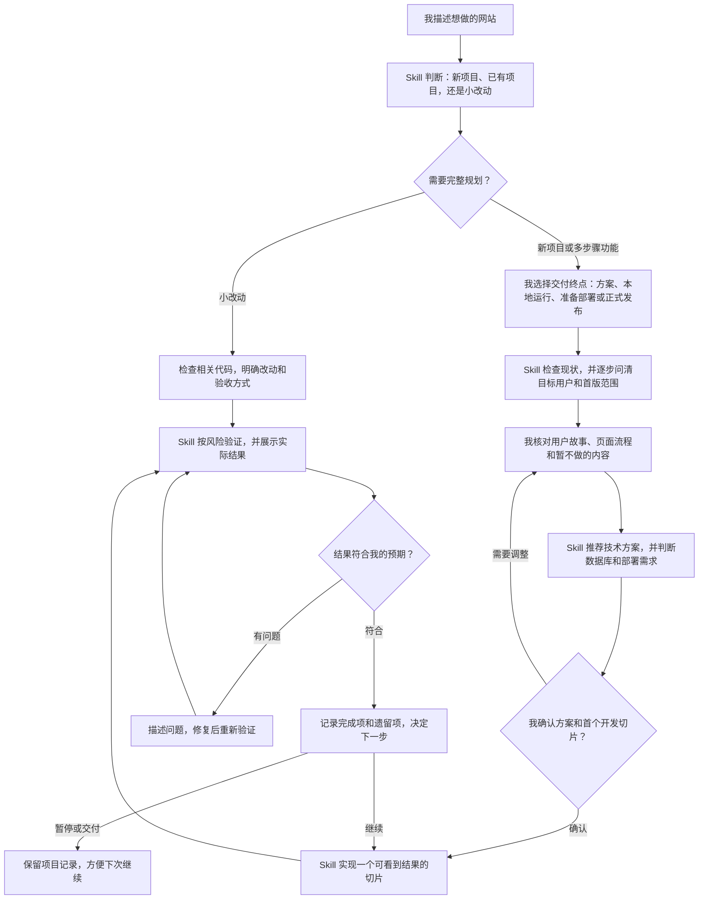
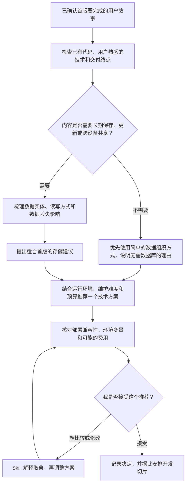
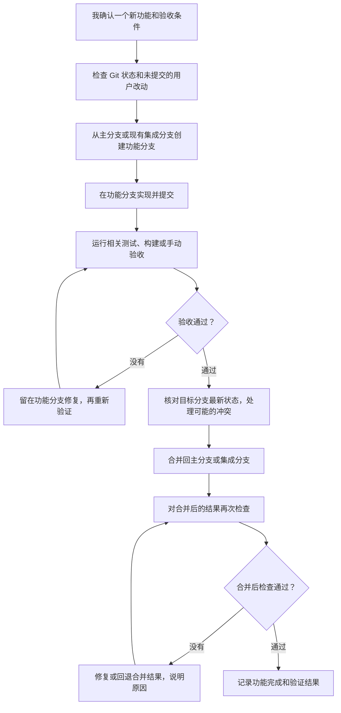

# Vibe Coding Workflow：流程草图

这些草图从使用者视角解释 Skill 如何推进小型 Web 项目。实际步骤会按任务规模和用户选择的交付终点调整；具体指令见 [`SKILL.md`](../vibecoding-workflow/SKILL.md)。

## 1. 我从一个想法开始

用户只需用自然语言描述目标；重要产品决定由用户确认。已明确给出的信息不重复询问。

## 2. 技术、数据库和部署怎么决定

版本、平台能力或价格等易变信息需要核验当前官方资料。正式资源和发布操作按用户选定的交付程度推进。

## 3. 新功能如何经过 Git 分支回到主分支

明确的小修复可按项目习惯决定是否开分支。新功能会先在功能分支通过相关验收，再合入主分支；合并后的检查用于发现集成问题。
